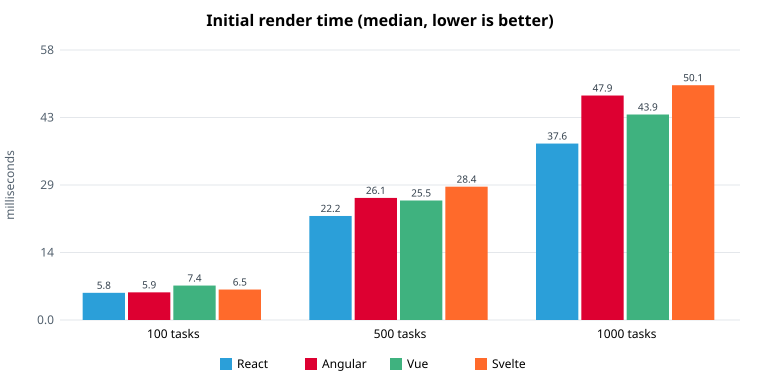
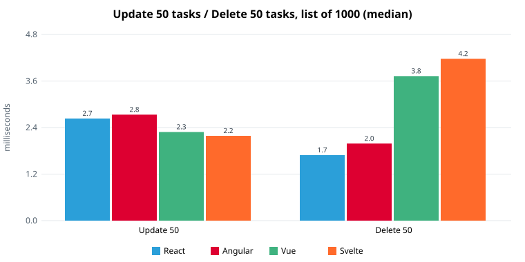
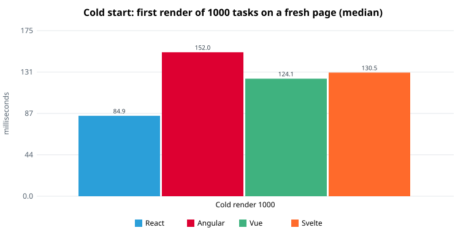
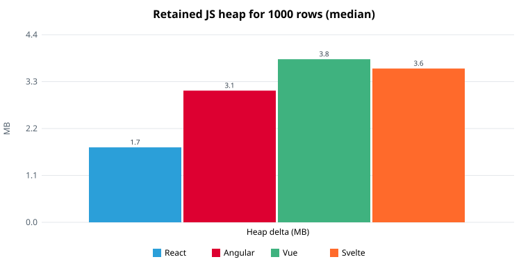

# Benchmark Results

- Browser: headless Chromium 141.0.7390.37, Node v22.22.2, no CPU throttling
- Each cell: **median of 30 iterations** after 5 warm-up iterations, in milliseconds, with ±standard deviation. Best per row in bold.
- Timer covers JS work + the framework's DOM flush + forced style/layout (paint excluded). See the README for the method.
- Update/delete operate on 50 tasks (the first 50 rows) of a list that has the given number of tasks.
- Run date: 2026-10-03T01:35:58.074Z

### Initial render (ms)

| Tasks | React | Angular | Vue | Svelte |
|---|---|---|---|---|
| 100 | **5.8** ±1.6 | 5.9 ±3.2 | 7.4 ±2.5 | 6.5 ±2.2 |
| 500 | **22.2** ±6.0 | 26.1 ±8.9 | 25.5 ±6.3 | 28.4 ±8.1 |
| 1000 | **37.6** ±9.4 | 47.9 ±13.9 | 43.9 ±13.8 | 50.1 ±18.7 |

### Update 50 tasks (ms)

| Tasks | React | Angular | Vue | Svelte |
|---|---|---|---|---|
| 100 | 1.6 ±0.6 | 1.5 ±0.7 | 1.7 ±1.1 | **1.3** ±0.8 |
| 500 | 2.2 ±1.1 | **1.7** ±1.1 | 2.0 ±1.0 | 1.7 ±1.2 |
| 1000 | 2.7 ±1.8 | 2.8 ±1.9 | 2.3 ±0.8 | **2.2** ±1.1 |

### Delete 50 tasks (ms)

| Tasks | React | Angular | Vue | Svelte |
|---|---|---|---|---|
| 100 | **0.7** ±0.3 | 1.0 ±0.9 | 0.9 ±0.8 | 0.7 ±0.7 |
| 500 | 1.4 ±0.4 | **1.3** ±2.0 | 2.2 ±1.6 | 2.2 ±1.6 |
| 1000 | **1.7** ±1.2 | 2.0 ±1.0 | 3.8 ±2.8 | 4.2 ±2.1 |

### Cold start: first render of 1000 tasks on a fresh page (ms)

| | React | Angular | Vue | Svelte |
|---|---|---|---|---|
| median (n=15) | **84.9** | 152.0 | 124.1 | 130.5 |

### Memory and size

| Metric | React | Angular | Vue | Svelte |
|---|---|---|---|---|
| Retained JS heap, 1000 rows (MB) | **1.70** | 3.10 | 3.80 | 3.60 |
| DOM elements, 1000 rows | 5019 | 5023 | 5019 | 5019 |
| JS+CSS bundle, gzip (KB) | 69.0 | 64.7 | 27.2 | **15.6** |
| JS+CSS bundle, raw (KB) | 220.5 | 202.5 | 68.6 | 40.2 |

## Charts

